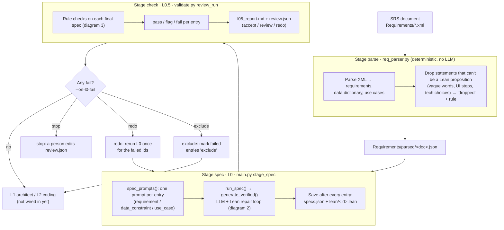
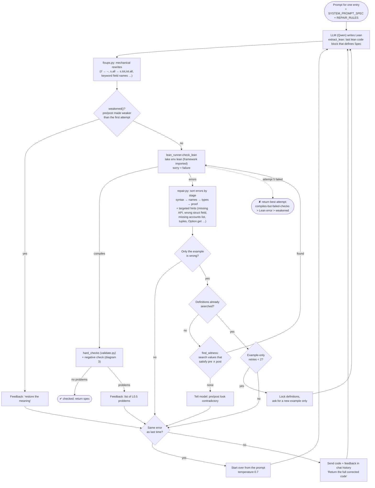
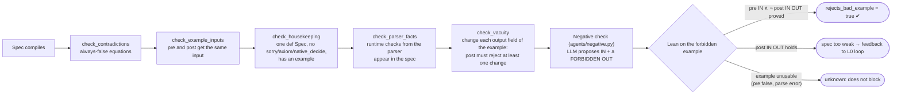
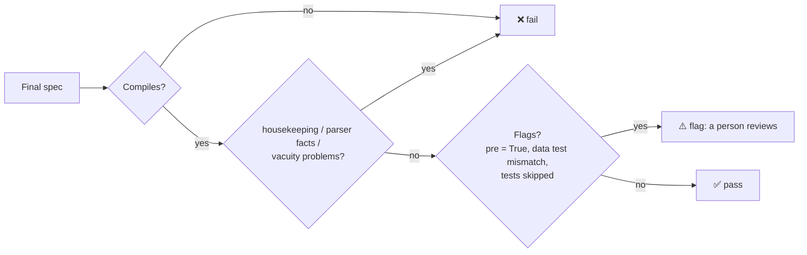

# ContractForge: how L0 works (English requirement → checked Lean spec)

Code: `harness/` (run from there with `python main.py`). Lean side: `framework/ContractForge/Contract.lean`.
Numbers in the last section are from the `qwen-v8` run on `0000 - gamma j.xml` (75 entries).

## 1. Whole pipeline

## 2. The L0 loop for one entry (`agents/base.py generate_verified`)

At most `MAX_RETRIES = 5` attempts. Each spec is Lean code: `structure Input`, `structure Output`,
`def Spec : Contract Input Output` with `pre` / `post`, and an `example` proving
`Spec.pre i ∧ Spec.post i o` by `decide`.

## 3. What "checked" means: the checks on a compiling spec

After L0, `review()` reruns housekeeping, parser facts and vacuity on the final spec, and adds
**data tests** for data-dictionary fields (length / charset / format / numeric bounds from the parser,
tested on valid and invalid sample strings) and the **`pre` is `True`** flag:

## 4. Results: qwen-v7 → qwen-v8

| | v7 | v8 |
|---|---|---|
| Specs that compile | 64/75 | **68/75** |
| Checked (passed every check in the loop) | 57 | **58** |
| L0.5 pass / flag / fail | 42 / 15 / 18 | **56 / 11 / 8** |
| Negative check: rejects / accepts forbidden / no verdict | 0 / 0 / 75 | **47 / 1 / 27** |
| Attempts per entry | 2.60 | 2.47 |

Remaining v8 failures: 7 don't compile (missing Lean APIs, Dijkstra with tuples, broken syntax),
1 vacuous `post` (3.5.3/S2), 3 correct data specs blocked by a wrong "forbidden" example from the
model, 3 specs that get the meaning wrong (CI-2, 5.5/R5, two logins), 2 examples with different inputs.
